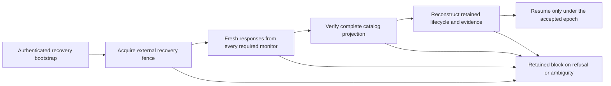

# Catalog operation and recovery decision

Status: proposed operating design and completed bounded feasibility pass, 2026-10-12.
This advances the [mission assessment](MISSION_REVIEW_2026-10-12.md). It admits no
provider, deployment, new protocol write, target or roadmap exception.

## Decision

**A public witness network is not a ready Etzio head catalog.** Select an application-aware
catalog with separately administered monitors and retained recovery data as the preferred
design. Evaluate Tessera as its log substrate, not as its operator or authority. Before
implementation, obtain an accountable catalog operator and at least two monitor operators,
plus the remaining native source roster. No operating commitment from a reviewed organization is retained.

The bounded public-document pass is complete. Its outcome is an operating decision with
unfilled dependencies, not an admitted provider. Do not repeat the survey or build another
codec while those dependencies remain unchanged. Daniel sponsors the decision and integration;
that does not appoint him as several independent provider principals.

| Option | Value and limit | Decision |
| --- | --- | --- |
| Existing public logs and witnesses alone | Useful anchor and consistency components; no complete Etzio semantic catalog, fresh recovery cut or data-custody agreement. | Insufficient as the complete native profile. |
| Dedicated catalog using Tessera, with independent monitors and retained data | Can express Etzio scope, publication ordering and recovery obligations; requires application code and real operators. | Preferred design, conditional on the operating dossier below. |
| Azure confidential ledger | Managed immutable transactions and receipts are relevant; this is one service trust domain, not Etzio's complete source roster. | Alternative to evaluate only with an explicit service/threat-model decision. |
| Several resources controlled through Daniel's account | Useful later as a synthetic interoperability environment. | Cannot establish independent administration. |
| Earlier customer-paid research lane | May shorten the route to paid work; does not close enterprise integrity gates. | The existing scoped roadmap-exception decision remains separate and unaccepted. |

Microsoft documents both write receipts and irreversible resource deletion. Neither a
receipt nor TEE branding removes the need for separately held recovery identity and data.
No Azure account, price, deployment or access was requested.
[Overview](https://learn.microsoft.com/en-us/azure/confidential-ledger/overview),
[receipts](https://learn.microsoft.com/en-us/azure/confidential-ledger/write-transaction-receipts).

## What the current protocols actually provide

[C2SP tlog-witness v1.1.0](https://c2sp.org/tlog-witness@v1.1.0) requires atomic
checkpoint advancement and persistence before responding. Its monitoring endpoint may
serve a delayed checkpoint; the one-hour guidance is a SHOULD, not a hard freshness bound.
The response is a stored checkpoint, without an Etzio request nonce or mission projection.
Consequently, a successful read alone cannot establish the newest Etzio head.

[C2SP tlog-mirror v0.1.0](https://c2sp.org/tlog-mirror@v0.1.0) gives a separate
cosigner a data-retention role: it signs after the covered entries are durably committed.
Its witness and mirror identities must be distinct when both services are offered.
This is a useful protocol for availability, not evidence that an available operator has
accepted Etzio data, retention duties or a semantic-monitor role.

Both specifications resolve to commit
`b2dd9892338af7009733a4575a6da05811ffae6c`, dated 2026-10-07. The pinned
[cosignature specification](https://c2sp.org/tlog-cosignature@v1.1.0) also recommends
ML-DSA-44 for new deployments. Etzio's released inspector handles a narrower Ed25519
checkpoint profile. A newer specification does not silently broaden that codec.
Additional cosigner semantics require an explicit identity/policy binding; different
Ed25519 cosigner identities must use different keys. A mirror signature cannot be relabeled
as an Etzio monitor statement.

[Tessera at c3971f9](https://github.com/transparency-dev/tessera/tree/c3971f91024cb4826c30582de2382460550ad718)
separates sequencing, integration and publication. Returning an entry index does not
establish publication. Witnessing and mirroring must be configured; both have a
`FailOpen` option. A proposed Etzio profile must require every configured source and reject
that option. The README still marks mirrored logs as beta while source support exists.

The pinned [publication awaiter](https://github.com/transparency-dev/tessera/blob/c3971f91024cb4826c30582de2382460550ad718/await.go)
parses checkpoint size using `CheckpointUnsafe`. Treat it as coordination, not independent
proof verification. Etzio would still verify origin, all signatures, inclusion, consistency
and semantic coverage itself. This is an integration responsibility, not a reported
Tessera vulnerability. No third-party code was built or run.

## Recovery needs a defined point in the history

The requirement is **no head older than a successfully finalized pre-loss transition may
be accepted**. With concurrent writers, “latest” also needs a defined observation point.
A nonce authenticates a response to a new request; it does not make a stale database current.
A storage service must advance durably before acknowledging, and read through an ordered
barrier rather than an unchecked cache.

An illustrative counterexample needs no broken signature:

| Step | History A | History B |
| --- | --- | --- |
| 1 | H0 is published with valid cosignatures. | Same H0 and signatures. |
| 2 | No later transition completes. | H1 completes after H0. |
| 3 | Local state is lost. | Local state is lost. |
| 4 | Recovery receives the H0 transcript. | A cache or adversary supplies the identical H0 transcript. |

Both observations can fall inside an allowed age window. A verifier seeing only those
bytes cannot distinguish the histories. Accepting H0 in both violates the requirement in
B. This is an indistinguishability argument about a proposed recovery input, not a defect
reproduction against Etzio's current fixture enrollment or any provider.

The proposed threat model requires at least one required monitor to remain honest, retain
its acknowledged history and reject rollback; authenticated bootstrap keys must survive
outside the lost state. Every configured monitor is still required for acceptance. This
assumption favors refusal under a failed or dishonest source and promises no availability
under such a failure. Organizational separation reduces correlated risk; it does not prove
honesty or survival. A complete loss of all independent state cannot be repaired by signatures.

The preferred native design is an authenticated read barrier at each semantic monitor.
Each monitor must have durably acknowledged every externally published Etzio head required
for local finalization. After loss, all required monitors authenticate one recovery request,
read their monotonic state, and bind the response to its nonce, instance, environment,
trust epoch, catalog origin and exact global/mission projection. A missing, divergent or
unprovably current response blocks. Their service and storage behavior must be measured;
adding a nonce field alone proves none of it.

A second design can put a fresh unpredictable recovery marker into the same log and require
its inclusion under all required witnesses. Under the stated append-only/honest-witness
assumptions, a consistent prefix containing that new marker cannot omit an earlier head
already acknowledged by a required honest witness. Recovery must still authenticate and
reduce the complete relevant prefix; membership of one older head is insufficient. This
alternative adds an external write, a grant/budget and publication latency. It is not
implemented or selected for acquisition.

For the first qualification, reconstruct the catalog projection from every authenticated
leaf between the pinned genesis and the recovery cut, within an explicit total-byte and
time budget. A server-selected list of matching entries can hide a newer head. A compact
index would need separately verified completeness/absence proofs before replacing this
full-prefix reconstruction; it is not an assumed optimization.

Both designs need a recovery epoch or equivalent fencing mechanism that prevents an old
writer from finalizing during recovery. Fence acquisition must be ordered at the same
external authority as head advancement, persist before acknowledgment, and be enforced on
every later write. Merely recording an epoch in the lost local database does not fence a
writer. A read cut without fencing supports a historical snapshot only; it cannot authorize
resuming consequential writes as if no newer head exists.

This is a proposed native protocol. The four local phases, two ordinary lifecycle writes,
immutable observations, authorized retry and terminal seal remain unchanged. Native fencing
or a recovery-marker write requires its own reviewed contract; it is not hidden inside an
existing fixture call. An externally published checkpoint may precede local finalization.
Recovery must reconcile that exact pending phase, not treat a catalog entry as proof that
all local bytes committed. Missing bodies, BLOBs or phase evidence cause a block. A fresh
head response does not authorize a retry: a retained block still requires the exact governed
recovery decision, and a terminal seal remains terminal.

## Candidate operating dossier

The [machine-readable dossier](evidence/catalog-recovery-decision-2026-10-12.json)
records admitted bindings as absent, separately from named prospects. No live keys or new
origins are invented. Existing public key observations remain documentary evidence in the
prior assessment.

| Responsibility | Concrete prospect or design | Unresolved acceptance obligation |
| --- | --- | --- |
| Catalog code and projection | Etzio-specific application over pinned Tessera; separate service from the kernel. | Responsible operator, origin, keys, single-writer/fence semantics, commit acknowledgment and cold reconstruction. |
| Catalog administration | A separately controlled operator; Daniel is integration sponsor only. | Named party accepting custody and independent signing/recovery control. |
| Required monitors | Glasklar Teknik and Geomys are first technical-inquiry prospects, not selected suppliers. | At least two actual semantic-monitor commitments, failure-domain review, current-state reads and complete projection retention. Their witness offerings do not establish these services. |
| Two anchors | Existing Seasalp/Ginkgo material is a compatibility lead. | Independence/shared-control review, exact leaf mapping, quotas, inclusion/consistency and restart evidence. |
| Recovery data | Independent mirror of catalog leaves plus protected backup of full canonical evidence. | Storage/retention/export commitments and key custody. Hash-only leaves cannot reconstruct their payloads. |
| Trusted time and revocation | Existing Sectigo/FreeTSA and other time research remains preparation. | Complete admitted rosters, current native material, bounded clocks, rotation and revocation at use. No source selected by this decision. |
| Recovery bootstrap | Separately retained instance/origin, trust epoch, roster, policy, key history and recovery authority. | Custodian and tested retrieval independent of the lost database, staging and cloud-admin credentials. |

[Glasklar](https://www.glasklarteknik.se/) publishes log/witness operation and a contact
address. [Geomys](https://geomys.org/) offers maintainer retainers and publishes a contact;
its client list includes Sigsum. Their technical and commercial relationships must be
recorded, not assumed independent. Neither advertises the exact Etzio semantic-monitor
commitment reviewed here. No inquiry has been sent and no price or willingness is known.

For either prospect, the finite technical inquiry is: can you operate a separately keyed
catalog or semantic monitor for an Etzio synthetic qualification instance, durably retain
its accepted head and full relevant projection, authenticate a fresh scoped recovery read,
enforce externally ordered writer fencing, and supply evidence of administration, recovery,
retention, rotation, incident response, limits and price? A response must distinguish these
duties from ordinary checkpoint witnessing. No contract, credential exchange, sensitive
payload, deployment or spending is included in that proposed inquiry.

The shared-dependency inventory must cover beneficial ownership, administrators, recovery
accounts, hosting/control planes, DNS, software supply chain, clocks and signing hardware.
Different keys or companies alone do not establish the required failure separation.
All roles need exact source, principal, origin where applicable, key, codec, policy,
retention, capacity and cost bindings before native admission.

## Acceptance experiment and refusal cases

The experiment remains proposed until the complete roster and exact grants are accepted.
Use public synthetic records only. Record every request, response, phase and provider
acknowledgment with its byte identity; retain both positive and negative outcomes.

1. Publish H0 then H1 through the complete admitted lifecycle. Preserve independently
   held bootstrap and canonical evidence backups, then remove only the disposable local
   database, cache and staging.
2. Fence old writers through the external authority and acquire the fresh recovery cut.
   Require H1 or a retained block. Reconstruct global and per-mission projections and all
   required canonical bytes before enabling a new write.
3. Exercise stale-but-recent H0, a new nonce over a stale monitor cache, stale bootstrap,
   withheld H1 leaves, witness-only receipts offered as mirrors, and entry sequencing
   without publication. None may resume at H0.
4. Exercise missing required sources, root conflict, unrelated mission projection,
   revoked/rotated keys, unknown trust epoch and a replayed recovery marker. Refuse rather
   than reduce the roster or reset history.
5. Race a surviving writer against fence acquisition; interrupt before and after each
   external acknowledgment and local phase commit. No old-epoch write may finalize after
   the fence. An ambiguous committed response is reconciled from retained state.
6. Remove mirror data or decryption keys after a valid head response. This may block
   recovery; it must not promote a digest into reconstructed evidence or silently use H0.

Success establishes only the tested native recovery profile and its stated trust/storage
assumptions. It does not qualify physical storage, independent execution or findings.
Latency and cost must include all required providers, publication wait, proof retrieval,
projection reconstruction, failures and retry custody. There is no defensible deployment
price or calendar completion date before operator terms and a concrete roster exist.

## Research implications and stop rule

[Rebound v2](https://arxiv.org/html/2511.13641v2), Burke et al., 2026-04-16,
was checked after finding the older v1. It assumes trusted execution and a protected
monotonic authority; its authorized rollback is recorded as new history. Its security
analysis is informal. The included meta-review leaves policy specification outside scope.
Etzio cannot replace independent
custody with this assumption or reinterpret governed retry/seal as authority to restore an
old canonical head. Selected threat-model, recovery and limitation sections were reviewed;
its artifact was not executed and publication status was not independently verified.

[Sokolov's nonce study v1](https://arxiv.org/html/2608.03534v1), 2026-08-04,
reports an appraisal replay gap and a fix in one emulated-TPM integration. Other schemes
were inspected rather than exercised; hardware and multi-verifier guarantees remain
outside its result. It motivates checking challenge comparison at the actual consumer.
It does not show that a fresh response contains the newest application state. Etzio has
not reproduced its reported third-party finding.

**Next action:** resolve the named operating commitments or explicitly choose a different
threat model/roadmap scope. The technical inquiry and acceptance requirements above are
ready for review; external messaging still requires Daniel's explicit instruction under
AGENTS.md. Do not infer consent from a provider's public contact details. If no operator is
available, return that operating constraint as the decision outcome instead of producing
more fixture adapters. Authorized repository repair remains possible when an actual defect
is demonstrated. The spent FreeTSA journal, unaccepted diagnostic and early paid-lane
exception retain their exact existing status. No bounty campaign starts from this decision.
