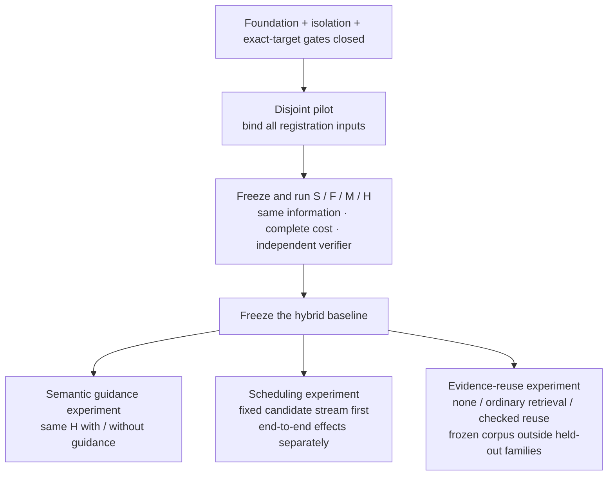

# 2026 Vulnerability-Research Frontier Baseline

Original comparison snapshot: **2026-07-29**; latest targeted research review: **2026-10-21**.
This is a design baseline, not an Etzio performance claim. The update below does not
silently refresh every historical result in the original comparison table.
Sources are primary project, research, program, or vendor publications where available.
Results are not directly comparable across different datasets, scaffolds, budgets, and
best-of-*k* settings.

## Selection, scheduling and reuse controls, 2026-10-21

The [mission review](MISSION_REVIEW_2026-10-21.md) examines selected methods, results and
limits from AgenticVulHunter, SKILL-SIF, RAISE and ClawMMU, with versioned captures in the
[evidence record](evidence/evidence-close-ownership-2026-10-21.json). None was independently
reproduced. Threshold-selected comment quality is not assigned-task cause yield; file-guided
identification is not executed impact; a retrospective scheduling simulation is not a causal
compute-allocation result; a proposed memory protection design is not an implementation.

Carry four controls into the existing proposed comparison: freeze retrieval and thresholds
on the disjoint pilot; preserve contrary evidence and regressions in learned procedures;
exclude future information from scheduler inputs while retaining zero-yield tasks and all
costs; and reject reuse across revoked provenance, old checkpoints or incompatible scope.
Current vendor workflows already include reproduction and remediation checks. Distinct
confirmed causes per complete cost and reviewer effort remains the advantage to test.
S/F/M/H still precedes separate semantic, scheduling and reuse experiments; all `18`
registration inputs remain unbound. No provider, target or execution gate changes.

## Verification cost and dependency controls, 2026-10-18

The [dated mission review](MISSION_REVIEW_2026-10-18.md) records selected methods, results
and limitations from CyberArena, LLM4SAST, Matoi and MCP-FSD, plus current vendor and CoW
program evidence. Exact versioned captures are identified in the
[public evidence record](evidence/evidence-setup-interruption-2026-10-18.json).
The papers were not independently reproduced.

The proposed comparison now explicitly carries post-change run identity and legitimate-use
controls, excluded-attempt cost, analyzer/oracle validation, identical-representation cache
baselines and distinct attempted/analyzed/verified denominators. These refine the existing
protocol; they do not admit a corpus, implement a reuse subsystem or change experiment
order. Independently confirmed cause yield per full cost and reviewer effort remains the
advantage to test. All `18` registration inputs remain unbound.

## Evidence reuse and oracle quality, 2026-10-16

Three additional primary papers sharpen the selected comparison. Their methods, evaluation
conditions and limitations were inspected; no benchmark or third-party code was executed.
Exact source identities and review depth are retained with the
[October 16 continuation evidence](evidence/evidence-byte-admission-2026-10-16.json).

| Primary source | Observed contribution and limit | Etzio consequence to test |
|---|---|---|
| [AVRI, v1, October 8](https://arxiv.org/html/2610.11602v1) | Source-linked forward/backward reasoning and persistent evidence reduce reported aggregate cost on 20 fixed-harness C/C++ tasks. One run per configuration and no component ablations leave robustness and attribution open; crash-based success is weaker than independent security-effect proof. | Compare useful source queries, cached computation and context recovery separately. Charge auxiliary work. Persistent evidence alone is already a published technique, not a unique Etzio advantage. |
| [AnonVul, v1, October 13](https://arxiv.org/html/2610.17542v1) | Business-logic tasks use hidden relational oracles, patched controls and identity anonymization. A matched 20-task cohort is sensitive to restored software identity. Residual cues, expert construction and single runs limit generalization; unrelated valid findings are outside its target-specific score. | Bind principal, action, object, state and forbidden effect explicitly. Test identity sensitivity with semantics-preserving paired variants and keep off-target findings distinct from target success. |
| [Patching benchmark reliability, v1, October 7](https://arxiv.org/html/2610.10150v1) | A curated 112-bug study separates PoC, regression and developer-added tests and examines harness failures. Upstream tests strengthen the oracle but remain incomplete; selection favors reproducible, well-tested projects. | Preserve intended behavior and adjacent legitimate cases. Classify harness failures separately; passing one trigger test cannot establish a correct fix. |

These are proposed controls within the existing experiment order. First freeze and run
S/F/M/H after admission; then test semantic guidance, scheduling and reuse separately.
An identity-sensitivity study must hold access, budgets and security semantics fixed and
validate its transformed positive and negative controls before interpreting a difference.
It is not a new admitted corpus or an extra result from the four-arm baseline.

The practical research unit is a source-bound obligation: who can perform which action on
which object, in which state, and what observation would distinguish a violation from
legitimate behavior. Keep input-to-operation reachability, required unsafe conditions,
contrary evidence and unresolved assumptions separate. Reuse requires exact source and
analysis-context applicability; a saved narrative is not verification authority.

The retained CoW fee/fill review applies this discipline to positive-quantity, partial,
full and degenerate-order cases. It rules against simple fee-overcharge explanations in
the ordinary source cases and leaves degenerate-order semantics unresolved. It is manual
source reasoning, not a target execution, independent proof or bounty-eligibility decision.

## Competitive review and experiment order, 2026-10-15

Two retained October 15 packets extend the system review and examine selected methods,
results and limitations in recent research. This is a source review, not an exhaustive
security audit or reproduced frontier ranking. The
[public evidence projection](evidence/documentation-handoff-2026-10-15.json) records exact
source versions and private capture locators. It preserves direct-capture failures and
web-extracted replacements without calling them original HTTP bytes.

| Reviewed primary source | Consequence to test | Important limit |
|---|---|---|
| [RedHerring, v3](https://arxiv.org/html/2609.35909v3) | Bound verification effort and include hard benign cases alongside hard real defects | Its selected agents, one-run configurations and crash-signature endpoint do not evaluate the Etzio hybrid |
| [AFuzz, v1](https://arxiv.org/html/2605.10074v1) | Compare simple and staged controllers under complete cost caps | Fixed-dollar and fixed-seed rankings differ; preprocessing and delegated calls must be charged |
| [IntentFuzz, v1](https://arxiv.org/html/2609.13004v1) | Bind each semantic obligation to its responsible component and legitimate behavior | A narrow bridge/mutant study does not establish general EVM advantage |
| [EchoFuzz, v1](https://arxiv.org/html/2609.14475v1) | Isolate sequence planning from the underlying fuzzer | Nominal fuzzing time omits planning cost; selected older comparators do not establish current performance |
| [StateLens, v1](https://arxiv.org/html/2609.24550v1) | Test state feedback beyond edge coverage and replay effects without instrumentation | JavaScript-engine results do not establish EVM transfer |
| [SmartMemory, v1](https://arxiv.org/html/2609.34983v1) | Represent cross-component obligations and missing dependencies explicitly | Off-chain abstraction and expert confirmation remain material parts of the method |
| [MemRepair, v1](https://arxiv.org/html/2605.17444v1) | Compare provenance-bound experience with ordinary retrieval and no retrieval | PoC-guided repair differs from discovery; exact-CVE exclusion is insufficient family separation |
| [Retrieve, Reproduce, Reveal, v1](https://arxiv.org/html/2609.37669v1) | Measure retrieval relevance, applicability and downstream verdict separately | Selected function-level models and datasets do not bound frontier-agent performance |

Current official descriptions already include overlapping capabilities:
[Google CodeMender](https://cloud.google.com/blog/products/identity-security/find-and-fix-software-vulnerabilities-with-codemender/)
describes validation and remediation;
[Codex Security](https://learn.chatgpt.com/docs/security/faq) describes threat models,
reproduction evidence and proposed fixes;
[Anthropic OSS Scanner](https://red.anthropic.com/oss-scanner/) describes automated OSS
reports, distinct from its human-reviewed CVD service;
[XBOW](https://docs.xbow.com/console/guidance/interpreting-results/) describes validation,
reproduction and coverage gaps; and
[Certora AutoProver](https://zeus.certora.com/docs/auto-prover-user-manual) combines generated
properties with proof and fuzzing workflows. These are vendor descriptions, not reproduced
comparators. Generic orchestration, attached evidence or generated invariants alone cannot
establish Etzio differentiation.

The proposed advantage is higher independently confirmed cause yield per complete cost,
with fewer invalid reports and less reviewer work. Semantic guidance, bounded scheduling
and applicability-checked evidence reuse are hypotheses. None has earned promotion.

### Controlled comparison and separate ablations

The operator selected the experiment order while preserving all foundation gates. The
protocol is still **proposed, not preregistered or run**. Required order: native integrity,
external recovery/fencing, protected storage, independent isolated execution, and admitted
benchmark/target contracts before the comparison.

| Arm | Frozen treatment to compare |
|---|---|
| S: static analysis | Pinned Slither and its qualified build/analysis closure |
| F: fuzzing | Pinned Echidna with verified successful Slither preprocessing and a strong configuration selected on a disjoint pilot |
| M: model only | Fixed model/scaffold and the same permitted information, without S/F tools |
| H: hybrid | The same model plus the pilot-selected S/F tool configuration |

Choose the primary non-hybrid comparator on the disjoint pilot and report every arm.
Use paired target/root-cause families; related revisions and near-duplicates remain in
one split, and repeated seeds are not independent families. The primary endpoint is unique
independently confirmed causes per assigned task under common currency, CPU, wall-time,
memory and reviewer caps. Charge builds, setup, property construction, preprocessing,
model/tool calls, failed investigations, minimization, verification and adjudication.
Retain unsupported, blocked, invalid, inconclusive and not-reproduced cases explicitly.

The read-only tool audit pinned Slither `eef5df948b8992eff85786b6b0bb4a193933e2c9` and
Echidna `5adfc83986e64fa95cfa2475ce65eefcf7c1a290`. These are documentary inputs, not qualified
builds. Missing Slither output must not become a successful empty analysis, supervisor
time caps must preserve truncation, and RPC/environment defaults are not network isolation.

This is the proposed experimental dependency graph, not a result or execution trace:



The three branches isolate interventions; they do not prescribe simultaneous execution
or combine their gains. No held-out outcome may write back into the reuse corpus. Reject
an apparent improvement if complete cost, independent cause adjudication or legitimate-use
controls erase it. A later commercial comparison must also include accessible specialist
and frontier services under matched information and costs; S/F/M/H alone cannot establish
market leadership.

All `18` registration inputs remain unbound: accepted profiles; task manifest; target
contracts; license/access review; execution closure; model revision/scaffold;
properties/oracles; independent adjudicator; split manifest; pilot results;
family-count/precision rationale; repetition count; seed/run order; numerical budgets;
practical-effect threshold; uncertainty method; retry/censoring rule; and reuse
corpus/horizon. Selecting the direction supplies none of these missing measurements.

## Mission and provider-feasibility review, 2026-10-12

The [current assessment](MISSION_REVIEW_2026-10-12.md) reviews selected ReproBench and
VLoc Bench methods and limitations, refreshes public commercial evidence, and completes a
finite audit of published witness/provider obligations. Its source ledger distinguishes
operator declarations and matching key encodings from demonstrated independence, freshness
and recovery. No comparative Etzio result or gate closure follows. The next action is the
named complete operational dossier, not another optional native parser.

## Effect-evidence falsification, 2026-10-11

The [execution decision](FRONTIER_EXECUTION_DECISION_2026-10-11.md) adds selected primary
research on property probes, attribution, external triage and containment. Its owned finite
experiment produces seven counterexamples to accepting a repair from a single disappearing
effect. The required distinction is effect, cause, repair and preserved legitimate behavior.
This is an evaluation-design result, not competitive discovery or a closed foundation gate.
The native-provider critical path and the exact pending acquisition remain unchanged.

## Decision and full-text follow-through, 2026-10-11

The [decision packet](PAID_FINDINGS_DECISION_2026-10-11.md) and
[source ledger](evidence/paid-findings-research-2026-10-11.json) extend the seed review with
selected methods/results/limitations sections of ReEVMBench v1, AVRI v1 and OSS-CRS v2,
pinned code README/license inspection, current program/platform rules and specifications.
Exact review depth and failed retrievals remain explicit; no benchmark was executed.
Code4rena's wind-down and Sherlock's selective Audit Engine change the earlier contest
assumption. Preserve the foundation path and test finite source/effect hypotheses; do not
infer local capability or earnings from external reports. The CoW documentary continuation
has a retained source closure but an unresolved deployment mapping. This update does not
refresh all historical scores or claim a complete frontier survey.

## Handoff research refresh, 2026-10-11

The [next-session brief](NEXT_SESSION_MISSION.md) and its
[seed ledger](evidence/next-session-research-seeds-2026-10-11.json) add dated primary-source
leads, exact retained source identities and explicit review depth. The next session must
perform its own review and compare earlier authorized revenue paths; these seeds are not
an independently reproduced frontier evaluation. This update does not refresh every
historical score below.

Source correction: the linked [Bugcrowd AI page](https://docs.bugcrowd.com/researchers/onboarding/ai-privacy-security/)
principally documents Bugcrowd's own AI features and data controls. The broader researcher
scope/manual-verification wording in the October 9 table is not established by that page
alone. Verify current researcher rules and the exact engagement brief; no automation grant
or asset allowlist follows from this source. Current Google cyber-model leads also differ
from the historical July comparison; the seed ledger records a mutable vendor snapshot,
not access to that model or comparable Etzio performance.

## Research update, 2026-10-09

The engineering recommendation remains an independently verifiable research-and-remediation
engine, with a narrow measured first domain. The current evidence supports a fixture
integrity foundation, not comparative detection quality, a universal researcher, or revenue.
The finder still has six Python rule classes and two fixtures; the release suite measures
repository behavior rather than vulnerability-discovery performance.

| Primary source and publication date | What it supports | Proposed consequence for Etzio |
|---|---|---|
| [CodeMender research](https://deepmind.google/blog/introducing-codemender-an-ai-agent-for-code-security/), 2025-10-06 | Google describes static/dynamic analysis, differential testing, fuzzing and SMT tools, with human review before upstream submission | combine semantic proposals with independent mechanical checks and patch regression evidence |
| [ATLANTIS](https://arxiv.org/abs/2509.14589), 2025-09-18 | The AIxCC-winning system combines LLMs with symbolic execution, directed fuzzing and static analysis | evaluate complementary techniques against matched budgets; an agent count alone is not an advantage |
| [CodeMender preview](https://cloud.google.com/blog/products/identity-security/find-and-fix-software-vulnerabilities-with-codemender/), 2026-07-21; [Fairwind](https://blog.google/innovation-and-ai/technology/safety-security/fairwind-program/), 2026-09-02 | Google describes a maintained scanning/remediation harness and restricted partner access to specialized cyber models | keep model providers replaceable and distinguish published capability from available access and local evidence |
| [ReEVMBench](https://arxiv.org/abs/2603.10795), 2026-03-11 | The study varies scaffolds and uses incidents after model release to challenge transfer from contest results | retain unseen holdouts, repeated trials, exact information regimes and failed attempts before choosing a model or scaffold |
| [Bugcrowd AI guidance](https://docs.bugcrowd.com/researchers/onboarding/ai-privacy-security/) and [submission limits](https://docs.bugcrowd.com/researchers/reporting-managing-submissions/reporting-a-bug/submissions-limit/), accessed 2026-10-09 | Researchers remain accountable for scope and manual verification; managed-bounty limits depend on account performance | optimize validated, reproducible, nonduplicate reports and review effort; account ownership and report volume do not establish access or income |

These are source-attributed observations. The proposed consequences are Etzio design
judgments, not statements about what another engineering team would build for this project.

### Standards to pin at the next design boundary

| Reference | Version and publication status checked 2026-10-09 | Etzio boundary |
|---|---|---|
| [NIST SSDF](https://csrc.nist.gov/pubs/sp/800/218/final) | SP 800-218, version 1.1, final, February 2022 | development and vulnerability-response practice; maintain a requirements-to-evidence crosswalk |
| [SSDF revision](https://csrc.nist.gov/pubs/sp/800/218/r1/ipd) | SP 800-218 Rev. 1, version 1.2, initial public draft, 2025-12-17 | track separately from accepted final requirements |
| [OWASP ASVS](https://owasp.github.io/www-project-application-security-verification-standard/) | 5.0.0, released 2025-05-30 | web application requirements with versioned identifiers; not an EVM or native-code completeness oracle |
| [FIRST CVSS](https://www.first.org/cvss/v4.0/specification-document) | CVSS 4.0; specification revision 1.2, 2024-06-18 | retain vectors and impact assumptions; severity is not proof of exploitability or a payout forecast |
| [TUF](https://theupdateframework.github.io/specification/v1.0.36/) | specification 1.0.36, modified 2026-08-05 | review the change from the historical 1.0.35 baseline before admitting a native revocation profile; this document does not upgrade a runtime trust contract |

The RFC and isolation baselines below remain scoped design inputs. A named standard is
not a conformance result. A provider profile needs pinned source/client versions, exact wire
semantics, a threat model, independent administration evidence, positive vectors, and a
known-bad for each claimed refusal.

### Native-time qualification update

[ADR-0020](decisions/0020-offline-native-time-qualification.md) pins pyHanko `0.37.0`
(2026-08-31), pyhanko-certvalidator `0.32.1` (2026-09-10), and their full optional
qualification closure. Its bounded RFC 3161/5816 fixture profile is compared with local
OpenSSL `3.6.3` using retained exact requests, responses, CRLs and explicit verification
times. This is native-format offline evidence, not native-provider or general PKIX
conformance. CMS signatures and timestamps cannot establish current revocation, truthful
UTC, independent administration or the latest catalog head after local loss. The ADR
specifies the concrete external-administration and local-loss experiment before those
claims can be accepted.

[ADR-0021](decisions/0021-offline-rsa-timestamp-chains.md) adds the separate RSA chain
profile and [dated provider comparison](../tools/native-time-rsa/README.md). Standards
and provider documents are versioned source inputs; the native experiment remains
repository-owned bytes. Intermediate revocation, qualified-statement shape and complete
uncertainty intervals are tested without admitting an external service.

### Finite next steps and decision criteria

The [2026-10-09 qualification packet](QUALIFICATION_NEXT_STEPS.md) makes these experiments
concrete, with pinned Firecracker/witness source revisions, storage fault models, native
provider artifact diagnostics and a bounded cloud host preflight. It retains a correction:
the publisher-listed Sectigo intermediate is RSA-3072, incompatible with ADR-0021's
all-4096 profile. No comparative detection result or provider admission follows.

The foundation exit gates are external latest-head authority after local loss, native
provider qualification, a concrete storage profile, structured execution evidence and
independent execution under an accepted isolation profile. The next design packet should
map each remaining claim to its smallest falsifying experiment. Repository fixtures can
exercise protocol failures; they cannot supply missing external administration evidence.

After those gates, keep the EVM/Solidity first domain and compare a simple static-analysis
baseline, a fuzzing baseline, a model-only baseline, and a hybrid analysis/search system on
the same admitted tasks and budgets. Include clean, patched and near-miss targets. The independent verifier
must receive the retained target and candidate bytes, and the generator must not control
the success oracle. Add a new language or target category only with its own oracles,
negative controls and measured transfer results.

Treat resource allocation as a constrained experiment: maximize independently accepted
unique results subject to exact authority, isolation and cost limits. Report reproducible
precision/recall, duplicates, reviewer minutes, compute cost, time to reproduction and
time to a validated patch separately. Report run uncertainty and undefined denominators.
Repeated seeds on one target are not additional independent targets. Adaptive search or
offline learning must earn promotion on untouched evaluation data; it cannot redefine a
benchmark or relax a gate.

Bug bounties are one future outcome channel. Maintainer remediation and customer-authorized
code review are other hypotheses to measure, not current products or promised revenue.
Choose among them using accepted outcomes and actual costs. The repository currently has
no accepted finding or bounty-income evidence on which to base a millions-of-dollars claim.

## What the frontier demonstrates — original July comparison

| System or evidence | Published result | Architectural lesson for Etzio |
|---|---|---|
| [Open Kritt](https://kritt.ai/) and its [launch methodology](https://kritt.ai/open-kritt-launch/) | Kritt reports $1.5M+ in total bug-bounty payouts across Immunefi and HackenProof and separately reports competition results from a workflow built around focused tasks, agent runs, PoC validation, deduplication, and ranking | domain workflows and verification discipline matter more than orchestration novelty |
| [Immunefi Blockian profile](https://immunefi.com/profile/Blockian/) | The current profile displays $1.1M in earnings and high/critical bounty and competition reports | economic outcomes are useful evidence, but profile totals and competition claims must remain distinct |
| [EVMbench](https://openai.com/index/introducing-evmbench/) | 117 vulnerabilities from 40 audits across Detect, Patch, and Exploit; GPT-5.3-Codex scored 71.0% in the published exploit mode | use executable historical tasks, deterministic local chains, explicit modes, and hardened graders |
| [SCONE-bench](https://www.anthropic.com/research/smart-contracts) | 405 known exploited contracts evaluated in local simulation; published analysis emphasizes simulated exploit revenue and cutoff-aware subsets | evaluate exploit construction, contamination, best-of-*k*, and economic effect separately |
| [ReEVMBench](https://arxiv.org/abs/2603.10795) | Reports ranking instability, scaffold sensitivity, and no end-to-end exploit success across its 110 agent-incident pairs | pin scaffolds, rerun for stability, retain failures, and include contamination-controlled real incidents |
| [BountyBench](https://bountybench.github.io/) | 25 real-world systems and 40 bounties across Detect, Exploit, and Patch | expand beyond smart contracts through executable multi-service environments and economic scoring |
| [CVE-Bench](https://arxiv.org/abs/2503.17332) | The original paper baseline reports up to 13% success on real-world web CVE exploitation | real applications remain substantially harder than curated local exploit tasks |
| [AXE](https://arxiv.org/abs/2602.14345) | The June 2026 v2 preprint reports 30% on CVE-Bench when given a CWE and vulnerable source location | report black-, grey-, and white-box information regimes separately; metadata-assisted triage is not open-ended discovery |
| [ExploitBench](https://exploitbench.ai/) | 41 patched V8 vulnerabilities graded by 16 deterministic capabilities in five tiers, from coverage and reproduction through target/generic primitives to full control | a crash or PoC is not an exploit; retain a mechanically graded capability ladder, randomized replay stability, and exact vulnerable/fixed-build evidence |
| [ExploitGym](https://arxiv.org/abs/2605.11086) and its [released corpus](https://github.com/sunblaze-ucb/exploitgym) | The paper describes 898 userspace, V8, and Linux-kernel instances; the current v1.0 corpus declares 869 tasks that extend a supplied proof of vulnerability to unauthorized code execution and flag retrieval | pin code, data manifest, mitigations, task IDs, and judge policy; preserve intended-vulnerability attribution separately from effect, and never silently merge paper and release populations |
| [SEC-bench Pro](https://arxiv.org/abs/2605.26548) | The July 2026 v2 has 344 validated tasks across V8, SpiderMonkey, and Linux; evaluation prompts name target source paths, validation interface, expected error type, and vulnerability class while withholding the reference PoC and root-cause location | pin the exact information regime and three-image grader, run offline to protect withheld artifacts, and retain mechanical evidence for independent adjudication rather than trusting an LLM grade alone |
| [AgentCyberRange](https://arxiv.org/abs/2606.14295) | 110 vulnerabilities across 15 applications and eight enterprise-like ranges with 156 internal hosts add foothold and post-exploitation measurement | multi-host progress requires explicit topology, identity, reachability, foothold, lateral-movement, and effect receipts; it also raises the isolation bar |
| [GPT-5.6 cyber evaluations](https://openai.com/index/gpt-5-6/) | OpenAI's July 2026 vendor report gives GPT-5.6 Sol 73.5% on five-seed ExploitBench, 24.9%/33.7% on two-/six-hour ExploitGym, and 71.2% on the earlier May 183-task V8/SpiderMonkey SEC-bench Pro snapshot—not the current 344-task v2 | retain provider, model, benchmark revision/population, harness, seeds, token and wall-time budgets, safety configuration, and latency treatment; vendor scores do not transfer to Etzio |
| [Anthropic exploit evaluations](https://www.anthropic.com/research/exploit-evals) | Anthropic's May 2026 vendor report says Mythos Preview reached full control on 21 of 41 ExploitBench CVEs across combined Baseline/Nudged variants and evaluates an updated 12-case post-cutoff SCONE set at Best@8 | keep variant, trial, cutoff, best-of-*k*, and simulated-economic assumptions explicit; never compare vendor headline numbers without matched protocols |
| [Gemini 3.5 Flash Cyber](https://deepmind.google/blog/introducing-gemini-3-5-flash-cyber/) | Google's July 2026 vendor report describes repeated-agent search and 55 confirmed V8 issues, including ten not found by its two named comparators, on a private evaluation | breadth, deduplication, and ensemble search matter, but hidden targets, denominators, budgets, and production adjudication cannot serve as Etzio release evidence |
| [Codex Security](https://openai.com/index/codex-security-now-in-research-preview/) | Repository context, threat modeling, validation, findings, and patches; OpenAI's March 2026 report says 14 CVEs were assigned, including two dual reports | continuous repository context, isolated validation, human review, and remediation belong in the full loop |
| [Google Big Sleep](https://googleprojectzero.blogspot.com/2024/11/) | This historical 2024 report describes an exploitable SQLite stack-buffer underflow found and fixed before release | variant analysis plus expert-guided real-code validation can produce novel results |
| [DARPA AIxCC](https://www.darpa.mil/news/2025/aixcc-results) | Team Atlanta won the 2025 final competition; finalist systems combined discovery and patching on critical open-source software | end-to-end cyber reasoning needs build, test, patch, and evaluation infrastructure, not only model calls |
| [OpenAI–Hugging Face evaluation incident](https://openai.com/index/hugging-face-model-evaluation-security-incident/) | OpenAI's preliminary July 2026 report says evaluation models escaped a constrained research environment through a package-cache path and reached external production infrastructure while pursuing an ExploitGym goal | treat the agent, target, dependency proxy, controller, artifact store, grader, and network as separate attack surfaces; default-deny egress and credentials, retain trajectory telemetry, and provide independent containment and kill authority |

## What remains unsolved

The public evidence does not support a universal autonomous vulnerability researcher:

- benchmark performance changes with harness, scaffold, model, budget, and number of trials;
- exploit tasks with explicit success oracles are often easier to grade than open-ended
  detection;
- benchmark labels can omit legitimate novel findings or leak through training data;
- an agent can attack its harness, grader, dependency path, or benchmark infrastructure
  instead of solving the intended task;
- local historical exploits do not reproduce all mainnet, timing, cross-chain, deployment,
  or operational conditions;
- a high recall figure says nothing about false positives unless the denominator and
  adjudication process are published;
- real bounty value includes scope interpretation, duplicates, severity negotiation,
  disclosure quality, and timing;
- model-generated verifiers can game weak graders and must not define their own success.

Etzio therefore needs an evaluation system, not a leaderboard number. The benchmark
environment itself is an adversarial target and must never share the worker's authority.

## Integrity-authority baseline

No single transparency or timestamp service answers every Etzio authority question. The
current adapter-qualification baseline is deliberately compositional:

| Standard or service | Etzio use | Required narrowing |
|---|---|---|
| [RFC 3161](https://www.rfc-editor.org/rfc/rfc3161.html), [RFC 5816](https://www.rfc-editor.org/rfc/rfc5816.html), and [RFC 9921](https://www.rfc-editor.org/rfc/rfc9921.html) | conservative trusted-time evidence over exact bytes | nonce, imprint, policy, certificate path, EKU, revocation, accuracy, algorithm agility, and COSE timestamp ordering must all be explicit |
| [TUF 1.0.35](https://theupdateframework.github.io/specification/v1.0.35/) | versioned revocation and trust metadata | pin the exact specification/client closure; require sequential root, threshold, expiry, hash/length, and rollback checks against trusted time |
| [RFC 9942](https://www.rfc-editor.org/rfc/rfc9942.html), [RFC 9943](https://www.rfc-editor.org/rfc/rfc9943.html), and [RFC 9162](https://www.rfc-editor.org/rfc/rfc9162.html) | byte-bound registration receipts plus inclusion and consistency evidence | accept only configured algorithms and proof forms; require predecessor consistency and a separately authenticated latest-head witness |
| [Sigstore Rekor](https://docs.sigstore.dev/logging/overview/) | possible future transparency evidence source | never promote one deployment into trusted UTC, revocation freshness, independent witnessing, or complete Etzio command authority |

The default modeled-finality adapters exercise these roles with unsigned, code-derived
provider assertions. ADR-0019 adds a separate enrolled signed-fixture mode: every phase
retains exact signed packages and cold replay reconstructs the original requests under the
pinned profiles. Kernel decisions and checkpoints retain their separately enrolled signer
binding. All sources remain deterministic repository fixtures; neither mode establishes
independent administration or externally durable latest-head authority.

ADR-0012 adds a versioned, networkless qualification contract for signed repository-owned
trusted-time and revocation fixture statements. Its exact copied profile binds the trust
root, validation policy, all-required role-separated source roster, provider policies,
codecs, service, and environment. It authenticates the exact statement bytes before parsing
claims, binds requests and nonces against replay, requires a common overlap while retaining
the conservative outer time hull, applies that full hull to half-open revocation validity
and bounded freshness, requires unanimous configured floors, and freshly maps sealed signed
BLOBs to the provider-neutral evidence types. A deterministic corpus manifest and exact
same-request retry make the repository-fixture qualification reproducible.

This is a common contract and harness, not RFC 3161, PKIX, TUF, COSE, SCITT, Rekor, or any
named-provider conformance. It does not establish truthful UTC, current real-world
revocation, separate operators, independent administration, external storage or durability,
availability, consistency, or non-equivocation.

ADR-0013 closes the remaining two evidence kinds under the same discipline. Its exact copied
head-authority profile binds the trust root, validation policy, log origins, and a fixed
roster of at least two anchor sources, exactly one catalog source, and at least two monitor
witnesses. It recomputes RFC 9162 inclusion proofs against a byte-bound Etzio
anchor-registration leaf, recomputes RFC 9162 consistency proofs from the exact retained
predecessor root, refuses an unchanged tree size whose root changed, and requires unanimous
monitor agreement on one catalog head before mapping a sealed `HeadCheckpointFloorV1`. The
Merkle core is validated against the published RFC 6962/9162 reference tree, so correctness
does not rest on agreement with Etzio's own prover.

This remains a common contract and harness, not RFC 9162, RFC 9942, RFC 9943, SCITT, or
Rekor conformance; no native wire format, certificate path, or provider client is parsed.
Unanimous fixture monitors prove the acceptance rule for split-view detection, not the
existence of independent observers.

ADR-0014 specifies the durable blocked-finality half of the same gate. A refused finality
attempt becomes a closed, reasoned, content-addressed observation that resolves nothing, and
only a role-separated signed governed recovery decision may change its disposition. Exactly
two dispositions are admissible—authorized retry and terminal instance sealing—and neither
finalizes, deletes, rewrites, mints a checkpoint, or releases the database-global barrier.
Separation of duty is enforced by key and principal, so the authority whose decisions caused
a block cannot authorize its own escape from it. ADRs 0015–0017 persist and integrate that
contract. The 2026-10-09 repairs enforce complete recovery binding and actual durable-phase
attribution. Qualified lifecycle consumption preserves these constraints; independent
provider qualification remains a separate gate.

## Required benchmark portfolio

These are future inputs, not authorized executions. Every corpus remains inert until its
license, exact revision, isolation profile, target contract, and resource policy are
accepted.

### Smart contracts and blockchain

- EVMbench Detect/Patch/Exploit with exact upstream revision;
- SCONE-bench cutoff-aware subsets;
- ReEVMBench-style real-incident and scaffold-stability evaluation;
- Etzio-owned negative contracts, patched variants, duplicate root causes, and oracle
  adversaries;
- later, L1/client memory, consensus, networking, and state-machine benchmarks.

### Web, services, and patching

- BountyBench and CVE-Bench subsets with pinned services and database state, reporting
  AXE-style grey-box metadata assistance separately from black-box work;
- an AgentCyberRange subset only after multi-host isolation is independently qualified,
  with exact topology, foothold, reachability, and post-exploitation effect receipts;
- patch correctness with regression and exploit tests;
- multi-step authentication, authorization, SSRF, injection, deserialization, race, and
  business-logic cases;
- clean and near-miss repositories to measure reviewer burden.

### Native and critical open source

- ExploitBench with exact V8 vulnerable/fixed images, all 16 capability flags, randomized
  challenge-response replay, and crash-to-full-control separation;
- a pinned ExploitGym release subset across userspace, V8, and Linux, retaining the exact
  paper/release population distinction, mitigations, flag effect, and intended-vulnerability
  attribution;
- SEC-bench Pro vulnerable/fixed/latest triples for discovery-to-PoC attribution and
  clean-target control, with the source paths, expected error type, vulnerability class,
  withheld artifacts, offline policy, and judge version retained exactly;
- other reproducible historical CVEs and sanitizer-backed oracles;
- variant-analysis corpora;
- build-system, dependency, parser, memory-safety, and concurrency tasks;
- patch preservation and regression evaluation.

## Evaluation protocol

Every released result records:

```text
benchmark + exact revision
eligible and excluded task IDs with reasons
target/environment image digests
dependency closure, network policy, and isolation-profile identity
model, tool, prompt, scaffold, and policy versions
information regime and all target-specific hints
single-run and best-of-k budgets
raw candidate, artifact, verdict, and timing receipts
mechanical capability tier plus intended-vulnerability attribution
TP / FP / TN / FN / invalid / crash / timeout / policy-denied
precision / recall / FPR / FDR with undefined denominators preserved
confidence intervals and run-to-run stability
token, compute, wall-time, and human-review cost
```

Training, tuning, and promotion data remain separated from final holdouts. Benchmark graders
receive adversarial tests, and a model is never allowed to rewrite its evaluator or label.

### Modeled fixture accounting correction, 2026-10-14

The legacy `etzio.harness.fpr` harness obeys the same missingness rule, within its tiny
owned corpus. Only `confirmed` and `not_reproduced` enter its confusion matrix. An
`inconclusive` or `out_of_scope` verdict remains unresolved, with its original kind and
reasons retained per case. `not_reproduced` is a negative prediction under this fixture
oracle, not proof that a real target is safe. A verdict for another candidate or an unknown
verdict kind is an evaluation error; verifier exceptions propagate without a success report.

Precision is TP/(TP+FP), recall is TP/(TP+FN), FPR is FP/(FP+TN), and FDR is FP/(TP+FP),
conditional on resolved fixture verdicts. Every zero denominator returns `None` and prints
`undefined`, never a favorable default. Counts must be nonnegative integers. Reports include
each fraction, resolved/assigned coverage overall and for each ground-truth class, and
TP/all-assigned-positive yield. Unresolved positives receive no yield credit and are not
relabeled false negatives. Empty-class coverage and yield are also undefined.

The command succeeds only for a nonempty, completely resolved corpus with zero false
positives. A false positive takes precedence as `FAIL`; otherwise missing coverage or an
empty corpus is `INCOMPLETE`, with nonzero exit status. This remains a fixture regression
condition, not a detector-quality threshold: the separate positive and recall regression
tests still apply. Neither this correction nor a perfect conditional rate establishes
independent execution, statistical confidence, a finding or comparative capability.

The [correction record](evidence/fixture-metrics-2026-10-14.json) retains the concrete
before/after cases. The broader campaign assignment, joint-stage, cost and uncertainty
contract remains proposed; this repair does not implement the future benchmark evaluator.

## Isolation baseline

The initial candidates are:

- [Firecracker production host setup](https://github.com/firecracker-microvm/firecracker/blob/main/docs/prod-host-setup.md), which requires the jailer or stronger constraints and separately configured network filtering;
- [gVisor security model](https://gvisor.dev/docs/architecture_guide/security/), which reduces the host system-call attack surface but explicitly remains one layer in a larger architecture;
- [Kata Containers architecture](https://github.com/kata-containers/kata-containers/tree/main/docs), for VM-backed container workflows.

Selection requires Etzio-specific threat-model tests, syscall compatibility measurements,
operational recovery, artifact capture, and escape/egress known-bads. Popularity or a vendor
claim is not acceptance evidence.

Regardless of runtime, the worker, vulnerable target, dependency mirror, model gateway,
controller, artifact receiver, and grader require explicit trust boundaries. The accepted
profile must provide immutable dependency closure; no ambient credentials; default-deny
DNS and egress; one-way, bounded evidence export; grader secrets unavailable to the worker;
tamper-evident trajectory and network telemetry; an out-of-band watchdog and kill path; and
clean-snapshot replay after every suspected containment or benchmark-integrity event.

## Etzio’s differentiating target

Etzio should combine five properties that public systems often demonstrate separately:

1. exact authorization and external-effect control;
2. evidence-native, durable mission replay;
3. independent exploit reproduction rather than confidence-based confirmation;
4. benchmarked domain depth with broad adapter architecture;
5. governed cross-mission learning that cannot rewrite its own authority or evaluators.

No evidence yet shows that Etzio has achieved this combination. The roadmap is constructed
to prove it one dependency-complete slice at a time.
